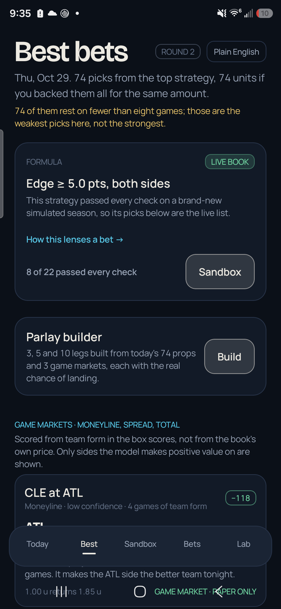

# Cheat Code

**A paper-trading lab for NBA props — on Android, with the reasoning shown.**

Cheat Code is not a tip sheet. A thesis is written in plain English, compiled into a rule, run against a simulated season, and only allowed onto the live board after it clears five checks: sample size, return on stake, a t-statistic, drawdown and hit rate. Every priced row goes into a paper ledger, and the segments that lose become the next challenger.

- **Two independent models:** player game-log form for props; team form from real box scores for the side and total.
- **Five-gate promotion:** 400+ bets, ROI above 1.5%, t-stat above 2.0, drawdown under 45%, hit rate above break-even.
- **Local-first:** the core models run on the phone. No account is required. Paper bets only.
- **Free core:** the board, the ledger, the sandbox and the learning loop. Premium adds capacity and the fantasy/sports-wire surfaces.



## Download

[propslab.vercel.app](https://propslab.vercel.app/) — signed APK, Android 10+, arm64.

## Repository map

| Path | What it is |
| --- | --- |
| `PropsLab/PropsLab/app/` | Kotlin / Jetpack Compose Android app |
| `PropsLab/PropsLab/app/src/main/java/com/propslab/domain/` | Odds, settlement and pricing maths |
| `PropsLab/PropsLab/app/src/main/java/com/propslab/sim/` | Simulated season, strategy grid and promotion gate |
| `PropsLab/PropsLab/app/src/main/java/com/propslab/agent/` | The tool surface and plain-English console |
| `PropsLab/PropsLab/app/src/test/` | 248 offline JVM tests |
| `site/` | Static storefront, manual and Vercel checkout/licence endpoints |
| `research/` | Independent formula tests and build notes |
| `PropsLab/PropsLab/audit/` | Android audit desk output and fixed-item log |

## Build the app

The native runtime is built from `vendor/llama.cpp`, which is intentionally not committed:

```bash
git clone https://github.com/ggml-org/llama.cpp vendor/llama.cpp
cd PropsLab/PropsLab
gradle wrapper          # once; the wrapper jar is not checked in
./gradlew :app:assembleDebug
```

A release build needs `keystore.properties` and the keystore it points at; both are ignored. Without them the build still produces an unsigned APK.

```bash
./gradlew :app:testDebugUnitTest
```

The four live ESPN smoke tests are skipped unless `PROPSLAB_LIVE_ESPN=1` is set.

## Run the site

The storefront has no build step:

```bash
cd site
python -m http.server 4173
```

Stripe endpoints need `STRIPE_SECRET_KEY` and `STRIPE_PRICE_ID` in the deployment environment. The browser never sees the secret key.

## Design notes

The palette carries meaning: aqua is the Over side, amber is the Under side, and a chalk tick marks the no-vig market. Bricolage Grotesque and Manrope are bundled as variable fonts under the SIL OFL (`PropsLab/PropsLab/FONT-LICENSE-OFL.txt`).

Paper bets only. Not affiliated with the NBA or any sportsbook. 18+.
